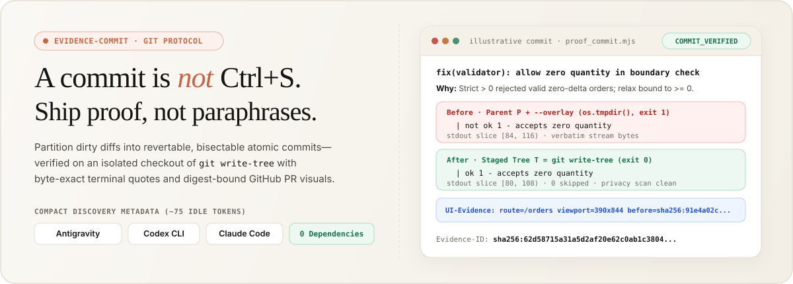
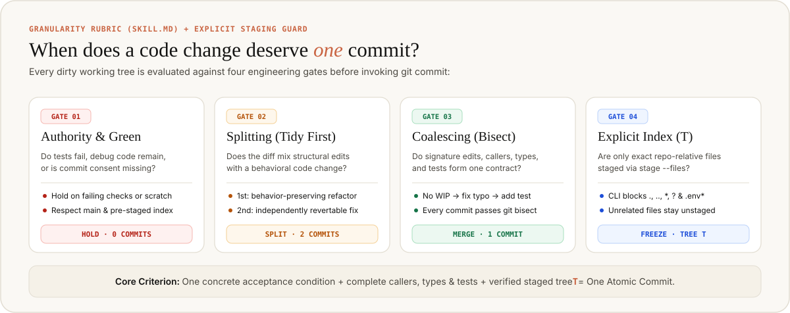
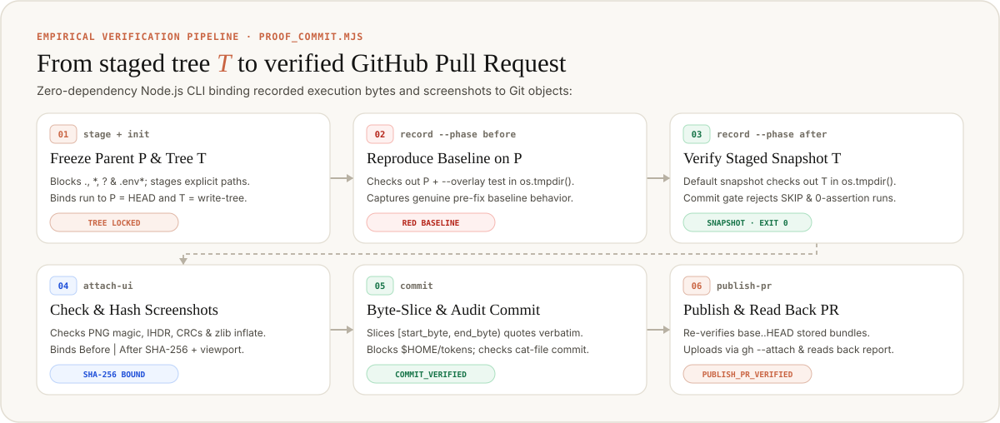

<div align="center">

<picture>
  <source media="(prefers-color-scheme: dark)" srcset="./assets/hero-dark.svg">
  <source media="(prefers-color-scheme: light)" srcset="./assets/hero-light.svg">
  
</picture>

<p>
  <a href="https://github.com/B143KC47/evidence-commit-skill/actions/workflows/ci.yml"></a>
  <a href="./LICENSE"></a>
  <a href="#4-end-to-end-quick-start">= 20.15" src="https://img.shields.io/badge/Node.js-%3E%3D20.15-157347.svg"></a>
  <a href="./skills/evidence-commit/scripts/proof_commit.mjs"></a>
  <a href="#3-progressive-disclosure-installation-75-idle-tokens"></a>
</p>

<p>
  <strong>English</strong> · <a href="./docs/README.zh-CN.md">简体中文</a>
</p>

</div>

---

**Evidence Commit** pairs an engineering-grade **Commit Granularity & Evidence Skill** ([`SKILL.md`](./skills/evidence-commit/SKILL.md)) with a deterministic, **zero-dependency Node.js verifier** ([`proof_commit.mjs`](./skills/evidence-commit/scripts/proof_commit.mjs), Node.js `>= 20.15` / `>= 22.2`) for autonomous coding agents (**Google Antigravity**, **OpenAI Codex CLI**, and **Claude Code**).

> **A commit is not `Ctrl+S`.** Every commit in shared history should represent one revertable, bisectable engineering transition—carrying a causal explanation of *why* the code changed, byte-exact terminal output proving the **exact staged Git tree (`git write-tree`)** works, and digest-bound `Before | After` screenshots when UI changes.

---

## Launch Film — Our Philosophy in 68 Seconds

https://github.com/user-attachments/assets/eace25a5-b892-4e14-9f8f-736ac110578a

*1080p · BT.709 · Sound on (scored with real chamber orchestra & foley: VSCO 2 CE CC0, Freesound CC0, and coastal surf by Luftrum CC BY 3.0). Beat-cut horizons, a typed challenge — "Prove that this commit actually fixed the bug." — fourteen ways AI commits fail, then a self-drawing making-of: staged tree `T`, an `--overlay` Before on `P`, byte-exact After quotes, and a GitHub PR carrying its own proof. On-screen runs are illustrative; every output line uses the real `proof_commit.mjs` format.*

---

## Why Ordinary AI Commits Break Software Engineering

Autonomous agents routinely degrade Git history through three structural failure modes:

| Failure Mode | Typical AI Agent Behavior | `evidence-commit` Approach |
| :--- | :--- | :--- |
| **1. Broken or Tangled Granularity** | Either micro-commit chains (`WIP` → `fix typo` → `add test`) that break `git bisect`, or `git add .` sweeps mixing refactors, bugfixes, and `.env` files. | Pairs **Four Granularity Gates** in [`SKILL.md`](./skills/evidence-commit/SKILL.md) (*Tidy First* structural/behavioral separation + call-site coalescing) with `stage --files` guards blocking `.`, `..`, `*`, `?`, and `.env*`/key files. |
| **2. Staged-Tree vs. Working-Copy Drift** | Tests pass in a dirty working folder (`cwd`) while `git commit` records a broken index (`T = git write-tree`). | Default `--mode snapshot` checks out `T = git write-tree` into a fresh `os.tmpdir()` directory via a private temporary `GIT_INDEX_FILE` before running verification (or records `Verification: workspace` explicitly when workspace mode is required). |
| **3. Paraphrased or Skipped "Proof"** | Summarizes terminal output from memory, silently edits quotes, or treats `0 passed / 1 skipped` (`exit 0`) as green. | Slices raw `[start_byte, end_byte)` stream offsets without `.trim()`, rejects `SKIP` / `0-pass` runs at commit verification, blocks `$HOME`/secret patterns in public text, and checks `git cat-file commit HEAD` byte-for-byte. |

---

## 1. What Deserves One Commit? (The Granularity Rubric)

<picture>
  <source media="(prefers-color-scheme: dark)" srcset="./assets/granularity-dark.svg">
  <source media="(prefers-color-scheme: light)" srcset="./assets/granularity-light.svg">
  
</picture>

| Engineering Scenario | Granularity Decision | Operational Test |
| :--- | :--- | :--- |
| **Reusable helper extraction + bugfix** | **Split into 2 commits** | Commit behavior-preserving `refactor` first (*Tidy First*), then the independently revertable `fix`. |
| **Signature change + 6 callers + types + test** | **Coalesce into 1 commit** | Omitting any caller breaks build/tests and violates `git bisect`. |
| **TDD (`write failing test` → `write fix`)** | **1 commit (`--overlay` Red → Green)** | Mount the new test onto parent `P` via `--overlay` to capture genuine `Before` failure, then commit implementation + test together. |
| **Bugfix + repo-wide formatting** | **Split or drop formatting** | Formatting noise masks behavioral diffs during code review and breaks targeted `git revert` / `git blame`. |
| **Lockfile / schema / codegen caused by edit** | **Same commit as its cause** | A clean checkout of tree `T` must install, build, and pass contract checks standalone. |

Full edge-case specification: [`granularity-and-contracts.md`](./skills/evidence-commit/references/granularity-and-contracts.md).

---

## 2. Tree-Bound Verification & GitHub PR Pipeline

<picture>
  <source media="(prefers-color-scheme: dark)" srcset="./assets/pipeline-dark.svg">
  <source media="(prefers-color-scheme: light)" srcset="./assets/pipeline-light.svg">
  
</picture>

### Illustrative Commit Object (Formatted by `proof_commit.mjs`)

Every commit generated by `proof_commit.mjs` is written with `git commit --cleanup=verbatim` and immediately checked via `git cat-file commit HEAD` for exact `tree`, `parent`, and byte-identical message body:

```text
fix(validator): allow zero quantity in boundary check

Why:
Validator rejected 0 with strict > 0 comparison despite API contract allowing
zero-delta adjustments; relax lower bound to >= 0 and lock with boundary test.

Evidence:
- Baseline: a1b2c3d4e5f6; overlay [tests/validator.test.mjs@blob:4a8e91c02b]
- Verification: snapshot; candidate tree 8f3a91c4e2b0
- Case: Zero quantity is accepted by order validator
- Before (node --test tests/validator.test.mjs, exit 1, stdout):
  | not ok 1 - accepts zero quantity
- After (node --test tests/validator.test.mjs, exit 0, stdout):
  | ok 1 - accepts zero quantity

UI-Evidence: route=/orders viewport=390x844 before=sha256:91e4a02c7b1f0833 after=sha256:4d8b71f92a06c41e
Evidence-ID: sha256:62d58715a31a5d2af20e62c0ab1c3804c5f5136fca1009098c8bc26b103082e9
```

---

## 3. Progressive-Disclosure Installation (~75 Idle Tokens)

`evidence-commit` is designed around **progressive disclosure**: during normal coding, reading, and debugging turns, agents keep only compact discovery metadata (`name` + `description`, ~75 tokens in `o200k_base` / `cl100k_base`). Full commit rules and `proof_commit.mjs` load on demand when deciding whether or how to commit.

### Option A — Install via `skills.sh` (Recommended)

```bash
npx skills add B143KC47/evidence-commit-skill
```

### Option B — Manual Workspace or Global Agent Setup

After cloning this repository locally:

```bash
# Workspace scope (Google Antigravity / OpenAI Codex CLI / Claude Code)
mkdir -p .agents/skills .claude/skills
cp -R skills/evidence-commit .agents/skills/evidence-commit
cp -R skills/evidence-commit .claude/skills/evidence-commit

# User-global scope (Codex CLI & Claude Code)
mkdir -p ~/.codex/skills ~/.claude/skills
cp -R skills/evidence-commit ~/.codex/skills/evidence-commit
cp -R skills/evidence-commit ~/.claude/skills/evidence-commit
```

To instruct your agent to activate the skill consistently before any `git commit` without bloating idle context, add one routing line to your global or project `AGENTS.md` / `CLAUDE.md`:

```markdown
- Before any `git commit`, load and follow the `evidence-commit` skill.
```

---

## 4. End-to-End Quick Start

Assuming `evidence-commit` is installed at `.agents/skills/evidence-commit` on a feature branch (e.g., `git switch -c fix/zero-quantity`):

```bash
# 1. Stage explicit repository-relative paths (`.`, `..`, `*`, `?`, and `.env*` are blocked)
node .agents/skills/evidence-commit/scripts/proof_commit.mjs stage \
  --files src/validator.mjs tests/validator.test.mjs

# 2. Initialize an evidence run locked to HEAD (P) and exact staged tree (T = git write-tree)
node .agents/skills/evidence-commit/scripts/proof_commit.mjs init \
  --case "Zero quantity is accepted by order validator"

# 3. Reproduce Before on parent P using the staged regression test overlay in os.tmpdir()
node .agents/skills/evidence-commit/scripts/proof_commit.mjs record \
  --phase before \
  --overlay tests/validator.test.mjs \
  -- node --test tests/validator.test.mjs

# 4. Verify After against a fresh os.tmpdir() snapshot of exact staged tree T
node .agents/skills/evidence-commit/scripts/proof_commit.mjs record \
  --phase after \
  -- node --test tests/validator.test.mjs

# 5. Assemble, privacy-scan, commit (--cleanup=verbatim), and check git cat-file commit HEAD
node .agents/skills/evidence-commit/scripts/proof_commit.mjs commit \
  --type fix \
  --scope validator \
  --title "allow zero quantity in boundary check" \
  --why "Validator rejected 0 with strict > 0 comparison despite API contract allowing zero-delta adjustments; relax lower bound to >= 0." \
  --pick-before "accepts zero quantity" \
  --pick-after "accepts zero quantity"

# 6. Push branch & publish per-commit verbatim evidence to GitHub PR (gh >= 2.103.0)
git push -u origin fix/zero-quantity
node .agents/skills/evidence-commit/scripts/proof_commit.mjs publish-pr \
  --base main \
  --title "fix(validator): allow zero quantity in boundary check"
```

When a commit modifies UI files (`--type ui` or visual component/stylesheet changes, where visual proof is required unless `--no-ui-impact` is explained), bind `Before | After` screenshots prior to `commit`:

```bash
node .agents/skills/evidence-commit/scripts/proof_commit.mjs attach-ui \
  --before ./artifacts/before-mobile.png \
  --after ./artifacts/after-mobile.png \
  --route "/orders" \
  --viewport "390x844" \
  --notes "Filter bar wraps cleanly at 390px with zero horizontal overflow"
```

---

## 5. Integrity, Security & Anti-Hallucination Guarantees

- **Isolated Snapshot Verification (`--mode snapshot` Default)**: Checks out `T = git write-tree` via a private temporary `GIT_INDEX_FILE` into `os.tmpdir()` so untracked workspace files, unstaged edits, and `assume-unchanged` / `skip-worktree` flags cannot fake a passing run.
- **Zero-Assertion & Skip Trap Rejection**: Rejects `After` verification at commit time when test output reports `# pass 0` / `ℹ pass 0` / `0 passed` or when selected lines contain only `SKIP` / `TODO` directives.
- **Byte-Exact Verbatim Quotes**: Every `  | <line>` quote maps to recorded raw byte offsets `[start_byte, end_byte)` without `.trim()` or paraphrasing; ANSI escapes (`\x1b`) and bare carriage-return overwrites (`\r`) are rejected.
- **Local-Path & Credential Leak Scanner**: Hard-fails prior to committing or publishing if public commit/PR text contains normalized `os.homedir()` paths or high-confidence secret formats (`ghp_`, `gho_`, `github_pat_`, `sk-`, `AKIA`, `Bearer`, PEM private keys); privacy-scanner error diagnostics never echo matched secret values.
- **PNG Structural Validation & GitHub PR Read-Back**: Validates PNG signature, positive `IHDR` dimensions, chunk CRC32 checksums (`zlib.crc32`), and `zlib` IDAT inflation while binding SHA-256 digests; uploads digest-named assets via `gh --attach`, preserves human PR notes outside bounded markers, and reads back the live GitHub PR to verify `headRefOid`, `baseRefName`, report body, and expected `https://` image references.

---

## 6. Run Automated Test Suite

```bash
node --test tests/*.test.mjs
```

---

## License

Released under the [MIT License](./LICENSE).
