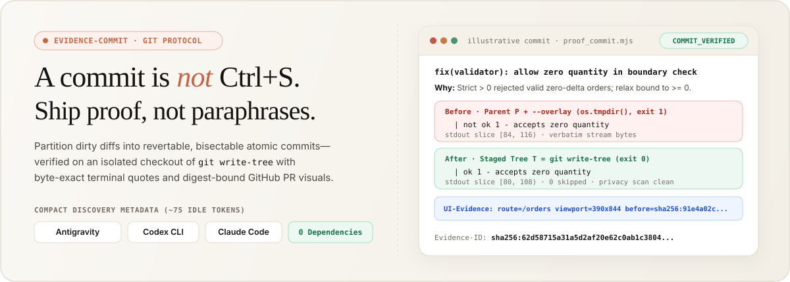
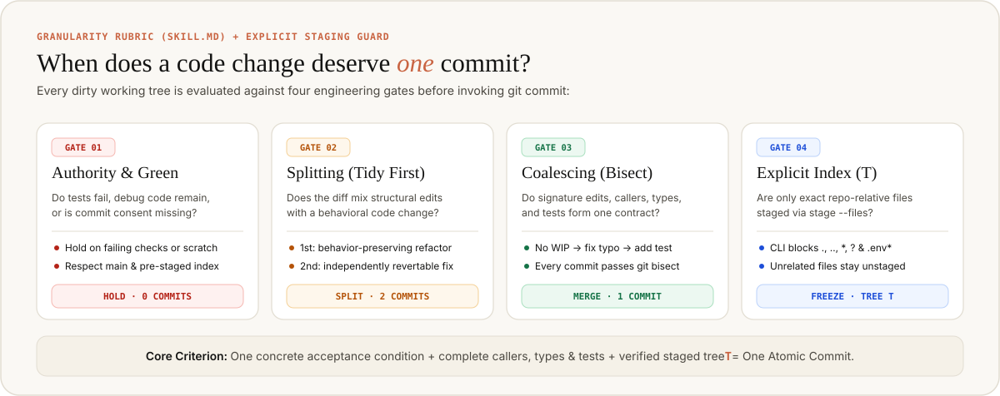
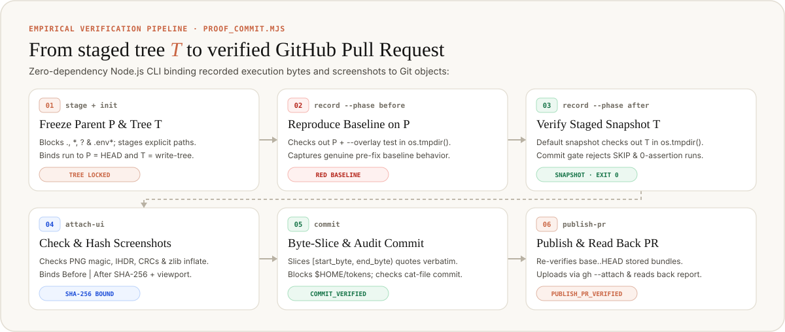

<div align="center">

<picture>
  <source media="(prefers-color-scheme: dark)" srcset="../assets/hero-dark.svg">
  <source media="(prefers-color-scheme: light)" srcset="../assets/hero-light.svg">
  
</picture>

<p>
  <a href="https://github.com/B143KC47/evidence-commit-skill/actions/workflows/ci.yml"></a>
  <a href="../LICENSE"></a>
  <a href="#4-端到端快速上手">= 20.15" src="https://img.shields.io/badge/Node.js-%3E%3D20.15-157347.svg"></a>
  <a href="../skills/evidence-commit/scripts/proof_commit.mjs"></a>
  <a href="#3-渐进式披露安装待机约-75-tokens"></a>
</p>

<p>
  <a href="../README.md">English</a> · <strong>简体中文</strong>
</p>

</div>

---

**Evidence Commit** 将软件工程级的**原子提交粒度准则**（[`SKILL.md`](../skills/evidence-commit/SKILL.md)）与**零依赖确定性取证 CLI**（[`proof_commit.mjs`](../skills/evidence-commit/scripts/proof_commit.mjs)，要求 Node.js `>= 20.15` / `>= 22.2`）结合，面向 **Google Antigravity**、**OpenAI Codex CLI** 与 **Claude Code** 等自主编程代理。

> **Commit 不是 `Ctrl+S`。** 共享主干历史中的每一次提交，都应当是一次**可独立回滚（`git revert`）、可二分定位（`git bisect`）的单一意图工程跃迁**——附带解释“为什么要这样改”的因果理由（`Why`）、在**精确暂存树（`git write-tree`）快照**上跑出的原文终端字节引文（`Before → After`），以及与 SHA-256 摘要绑定的 GitHub PR `Before | After` 视觉证据。

---

## 理念宣传片 — 42 秒看懂为什么需要 Evidence Commit

https://github.com/user-attachments/assets/e7eb23fe-38a0-433b-a3b0-e37b1c632713

*1080p60 · BT.709 标准色域（点击播放器音量键可开启极简原声）。直观展示“工作区绿灯、暂存树坏代码”的隐蔽错位、Tidy First 原子拆分准则，以及从快照字节取证到 GitHub PR 视觉对比卡片的完整闭环。*

---

## 为什么普通 AI Commit 会腐蚀工程历史？

日常开发中，AI 代理往往以三种典型方式破坏 Git 仓库的可维护性：

| 典型失效模式 | 普通 AI 代理的常见行为 | `evidence-commit` 的解决机制 |
| :--- | :--- | :--- |
| **1. 粒度过碎或大杂烩** | 要么连发 `WIP` → `fix typo` → `add test` 破坏 `git bisect`；要么一键 `git add .` 把重构、修 Bug 与 `.env` 混成一团。 | 将 [`SKILL.md`](../skills/evidence-commit/SKILL.md) 的**四道工程粒度门禁**（*Tidy First* 结构与行为分离 + 全调用点与测试聚合）与 `stage --files` 显式路径守卫结合，硬性拦截 `.`、`..`、`*`、`?` 及 `.env*`/密钥文件。 |
| **2. 工作区与暂存树错位** | 修复只保存在本地磁盘未 `git add`，工作目录跑测试绿灯，但 `git commit` 实际写入的是坏掉的暂存树 `T`。 | 默认 `--mode snapshot` 通过独立临时 `GIT_INDEX_FILE` 将 `T = git write-tree` 检出至 `os.tmpdir()` 执行验证（若需依赖工作区环境可显式指定 `--mode workspace` 并如实记录）。 |
| **3. 伪造引文与空跑假绿** | 凭记忆编造 `"All tests passed"`、手动删改报错，或把 `0 passed / 1 skipped`（`exit 0`）当成验证通过。 | 按子进程原始字节区间 `[start_byte, end_byte)` 原样切片引用（零 `.trim()`、零改写），在提交门禁处拒绝 `SKIP` / `0 passed` 假阳性、阻断 `$HOME` 路径与密钥泄露，并通过 `git cat-file commit HEAD` 逐字节核对提交对象。 |

---

## 1. 什么样的代码修改值得一次 Commit？（四道粒度门禁）

<picture>
  <source media="(prefers-color-scheme: dark)" srcset="../assets/granularity-dark.svg">
  <source media="(prefers-color-scheme: light)" srcset="../assets/granularity-light.svg">
  
</picture>

| 常见研发场景 | 标准工程决策 | 可执行判据 |
| :--- | :--- | :--- |
| **先提取通用函数，再修业务 Bug** | **拆分为 2 个有序 Commit** | 先提交保持行为不变的 `refactor`（*Tidy First*），再提交可独立 `git revert` 的 `fix`。 |
| **修改函数签名 + 6 处调用方 + 类型与测试** | **合并为 1 个原子 Commit** | 漏掉任何调用方都会导致编译或测试断裂，违背 `git bisect` 可二分性。 |
| **TDD（先写失败回归测试 → 再写修复代码）** | **1 个完整 Commit（`--overlay` 采红灯）** | 用 `--overlay` 将新测试挂载回父提交 `P` 诚实采集 `Before` 失败日志，再将实现与测试一并提交。 |
| **修 Bug 顺手格式化全仓代码** | **拆分或丢弃无关格式化** | 大面积格式化噪音会掩盖核心行为改动，并破坏精准 `git revert` 与 `git blame`。 |
| **改动直接引发的 Lockfile / Schema / 代码生成** | **与起因放入同一 Commit** | 任何人在干净目录检出树 `T` 时，必须能直接安装、构建并通过契约校验。 |

完整边界场景与字段契约规范见：[`granularity-and-contracts.md`](../skills/evidence-commit/references/granularity-and-contracts.md)。

---

## 2. 绑定精确暂存树（`T`）与 GitHub PR 的全链路流水线

<picture>
  <source media="(prefers-color-scheme: dark)" srcset="../assets/pipeline-dark.svg">
  <source media="(prefers-color-scheme: light)" srcset="../assets/pipeline-light.svg">
  
</picture>

### 提交对象格式示例（由 `proof_commit.mjs` 生成的演示样例）

`proof_commit.mjs` 使用 `git commit --cleanup=verbatim` 原样写入提交说明，并在提交后立即通过 `git cat-file commit HEAD` 校验 `tree === T`、`parent === P` 以及提交正文与预组装消息逐字节完全一致：

```text
fix(validator): allow zero quantity in boundary check

Why:
Validator rejected 0 with strict > 0 comparison despite API contract allowing
zero-delta adjustments; relax lower bound to >= 0 and lock with boundary test.

Evidence:
- Baseline: a1b2c3d4e5f6; overlay [tests/validator.test.mjs@blob:4a8e91c02b]
- Verification: snapshot; candidate tree 8f3a91c4e2b0
- Case: Zero quantity is accepted by order validator
- Before (node --test tests/validator.test.mjs, exit 1, stdout):
  | not ok 1 - accepts zero quantity
- After (node --test tests/validator.test.mjs, exit 0, stdout):
  | ok 1 - accepts zero quantity

UI-Evidence: route=/orders viewport=390x844 before=sha256:91e4a02c7b1f0833 after=sha256:4d8b71f92a06c41e
Evidence-ID: sha256:62d58715a31a5d2af20e62c0ab1c3804c5f5136fca1009098c8bc26b103082e9
```

---

## 3. 渐进式披露安装（待机约 75 Tokens）

`evidence-commit` 采用 **渐进式披露**（Progressive Disclosure）架构：日常写代码、查文档、跑调试时仅驻留精简发现元数据（`name` + `description`，按 `o200k_base` / `cl100k_base` 实测约 75 Tokens）；只有准备评估或执行 `git commit` 时才会按需加载完整规程。

### 方式一：通过 `skills.sh` 一键安装（推荐）

```bash
npx skills add B143KC47/evidence-commit-skill
```

### 方式二：手动安装至项目工作区或用户全局目录

将本仓库克隆到本地后，可按需拷贝至项目级或用户全局技能目录：

```bash
# 项目工作区安装（Google Antigravity / OpenAI Codex CLI / Claude Code）
mkdir -p .agents/skills .claude/skills
cp -R skills/evidence-commit .agents/skills/evidence-commit
cp -R skills/evidence-commit .claude/skills/evidence-commit

# 用户全局安装（Codex CLI 与 Claude Code）
mkdir -p ~/.codex/skills ~/.claude/skills
cp -R skills/evidence-commit ~/.codex/skills/evidence-commit
cp -R skills/evidence-commit ~/.claude/skills/evidence-commit
```

若希望代理在每次提交前稳定加载该技能且不增加日常待机上下文，可在全局或项目 `AGENTS.md` / `CLAUDE.md` 中添加一行路由指令：

```markdown
- Before any `git commit`, load and follow the `evidence-commit` skill.
```

---

## 4. 端到端快速上手

假设已将技能安装至 `.agents/skills/evidence-commit` 并处于功能分支（如 `git switch -c fix/zero-quantity`）：

```bash
# 1. 显式暂存仓库相对路径（硬性拦截 `.`、`..`、`*`、`?` 与 `.env*`）
node .agents/skills/evidence-commit/scripts/proof_commit.mjs stage \
  --files src/validator.mjs tests/validator.test.mjs

# 2. 初始化取证会话，冻结当前 HEAD (P) 与精确暂存树 (T = git write-tree)
node .agents/skills/evidence-commit/scripts/proof_commit.mjs init \
  --case "Zero quantity is accepted by order validator"

# 3. 在 os.tmpdir() 中将新回归测试挂载回父提交 P，复现修复前真实失败 (Before)
node .agents/skills/evidence-commit/scripts/proof_commit.mjs record \
  --phase before \
  --overlay tests/validator.test.mjs \
  -- node --test tests/validator.test.mjs

# 4. 在 os.tmpdir() 干净快照目录检出精确暂存树 T，验证修复后真实通过 (After)
node .agents/skills/evidence-commit/scripts/proof_commit.mjs record \
  --phase after \
  -- node --test tests/validator.test.mjs

# 5. 字节级切取原文引文、执行隐私与密钥扫描、写入并复核 Git Commit 对象
node .agents/skills/evidence-commit/scripts/proof_commit.mjs commit \
  --type fix \
  --scope validator \
  --title "allow zero quantity in boundary check" \
  --why "Validator rejected 0 with strict > 0 comparison despite API contract allowing zero-delta adjustments; relax lower bound to >= 0." \
  --pick-before "accepts zero quantity" \
  --pick-after "accepts zero quantity"

# 6. 推送分支并通过 GitHub CLI (gh >= 2.103.0) 发布带验证证据的 Pull Request
git push -u origin fix/zero-quantity
node .agents/skills/evidence-commit/scripts/proof_commit.mjs publish-pr \
  --base main \
  --title "fix(validator): allow zero quantity in boundary check"
```

当提交涉及前端界面改动（`--type ui` 或修改组件/样式文件，除非通过 `--no-ui-impact` 声明无视觉变化，否则强制要求视觉证据）时，在 `commit` 前附加 `Before | After` 截图：

```bash
node .agents/skills/evidence-commit/scripts/proof_commit.mjs attach-ui \
  --before ./artifacts/before-mobile.png \
  --after ./artifacts/after-mobile.png \
  --route "/orders" \
  --viewport "390x844" \
  --notes "移动端 390px 视口下筛选栏自动换行，消除横向溢出裁剪"
```

---

## 5. 完整性、安全性与反幻觉保障

- **默认隔离快照验证（`--mode snapshot`）**：通过独立临时 `GIT_INDEX_FILE` 将 `T = git write-tree` 检出至 `os.tmpdir()` 执行验证，避免工作区未跟踪文件、未暂存修改及 `assume-unchanged` / `skip-worktree` 隐藏标记伪造通过结果。
- **空跑与跳过测试拦截**：在提交审核阶段自动识别并拒绝 `# pass 0`、`ℹ pass 0`、`0 passed` 或所选引文仅包含 `SKIP` / `TODO` 的假阳性结果。
- **原始字节区间零篡改引文**：每一行 `  | <line>` 均精确对应原始输出流字节偏移 `[start_byte, end_byte)`，严禁 `.trim()` 或人工改写；包含 ANSI 控制码（`\x1b`）或裸回车覆盖（`\r`）的输出一律硬性拦截。
- **本地路径与高危凭据扫描**：提交与发 PR 前自动扫描公开文本中的 `os.homedir()` 本地路径及高危密钥格式（`ghp_`、`gho_`、`github_pat_`、`sk-`、`AKIA`、`Bearer`、PEM 私钥头），隐私扫描器的报错诊断绝不回显匹配到的敏感明文。
- **PNG 结构校验与 GitHub PR 回读核验**：校验 PNG 魔数、`IHDR` 正宽高、Chunk CRC32 校验和（`zlib.crc32`）与 `zlib` IDAT 解压流并绑定 SHA-256 摘要；通过 `gh --attach` 上传摘要命名截图、保留 PR 正文中人工撰写的备注，并在发布后回读远端 PR 核验 `headRefOid`、`baseRefName`、报告正文及预期 `https://` 图片引用。

---

## 6. 运行自动化测试套件

```bash
node --test tests/*.test.mjs
```

---

## 开源许可

本项目基于 [MIT License](../LICENSE) 开源发布。
